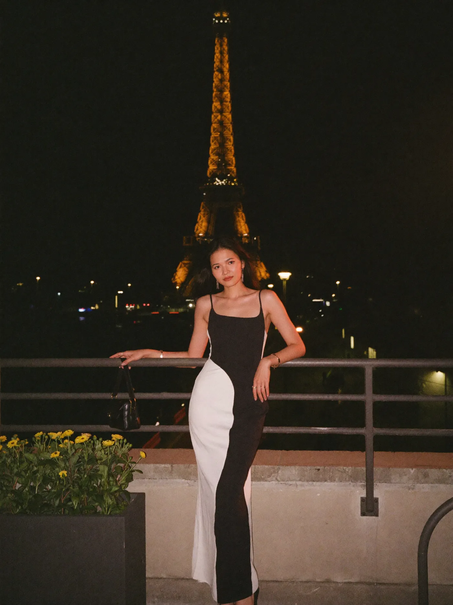
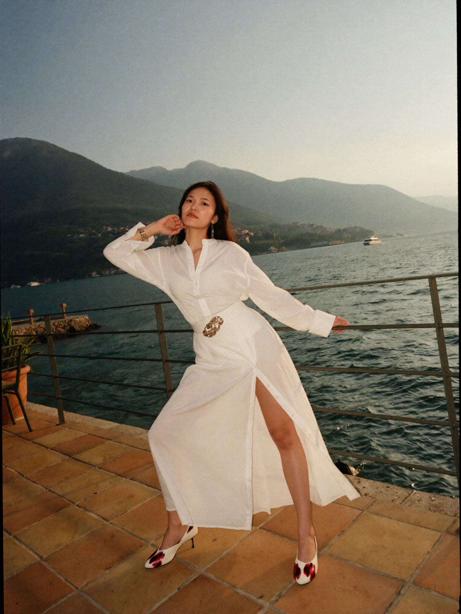
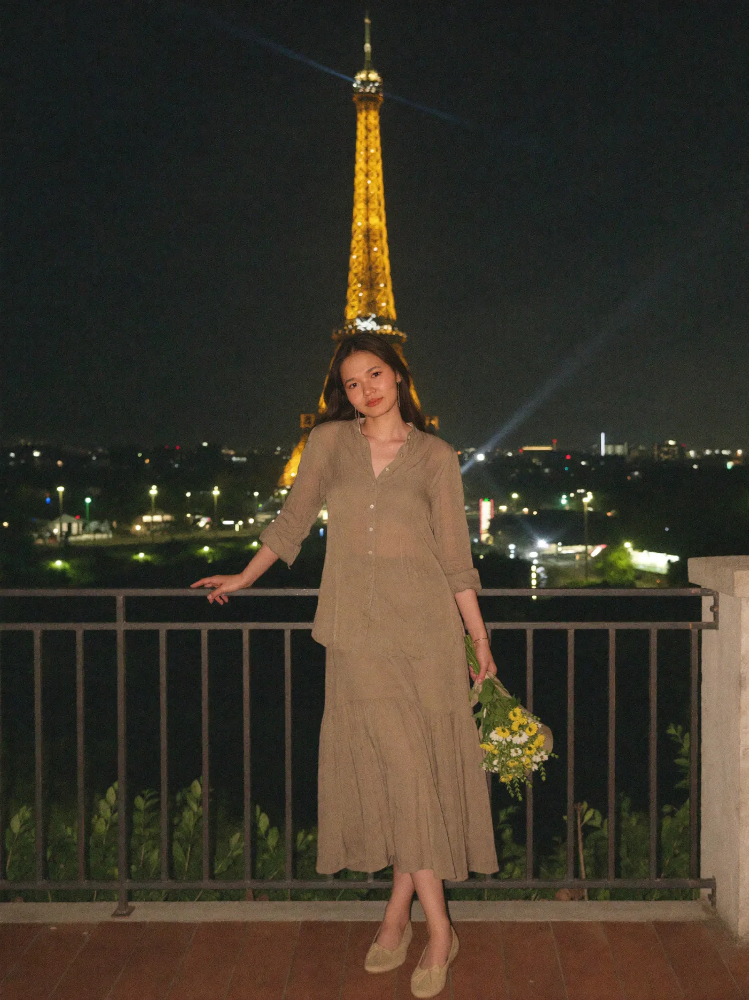
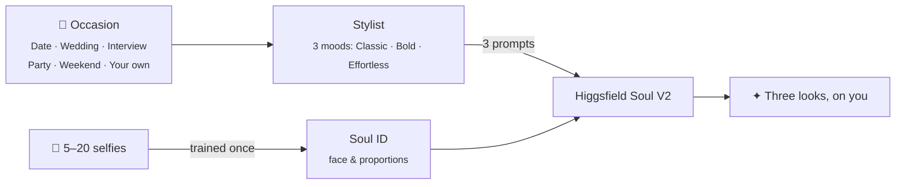

<div align="center">

# Kiim ✦

### Your stylist, *wearing* you.

Tell Kiim where you're going — and see yourself in three looks.

**[kiim-vert.vercel.app](https://kiim-vert.vercel.app)** · built on [Higgsfield](https://higgsfield.ai) Soul V2 + Soul ID

</div>

<br />

<table>
  <tr>
    <td width="33%"></td>
    <td width="33%"></td>
    <td width="33%"></td>
  </tr>
  <tr>
    <td align="center"><sub>LOOK 02 · BOLD</sub><br /><i>The Statement</i></td>
    <td align="center"><sub>YOUR OWN · PARTY</sub><br /><i>Lake Como at Sunset</i></td>
    <td align="center"><sub>LOOK 03 · EFFORTLESS</sub><br /><i>The Easy One</i></td>
  </tr>
</table>

<p align="center"><sub>Same face, three moods — every photo is generated, none of them was shot.</sub></p>

---

## The idea

Higgsfield can already *draw you* — but Soul ID is a creator's tool: you have to know how to write prompts.
**Kiim** (from Kazakh *«киім»* — clothing) is for the girl standing in front of her wardrobe asking
*"what do I wear?"*. She doesn't write prompts. She says **where she's going**, and a stylist puts together
three looks — and shows them **on her**, in her own avatar studio.

## How it works



1. **Your face.** A Soul ID is trained once on a handful of selfies, so every render keeps the same face and proportions.
2. **Your occasion.** Pick a preset or describe it in your own words — colours, place, shoes, light.
3. **Your looks.** The stylist turns it into three distinct looks — *Classic*, *Bold*, *Effortless* — each with a note,
   a list of pieces and a palette, rendered by Soul V2 on your Soul ID.

The stylist itself is deliberately **not an LLM**: every preset is a hand-written set of looks
([`lib/occasions.ts`](lib/occasions.ts)) — fabrics, cuts, shoes, place, light and camera. The copy and the prompts
are where the taste lives, so they're treated like code.

## Inside the studio

- **A stage, not a form.** The avatar stands in the centre in a soft orange glow; while the looks are being made an
  orange scan line runs over her and three panels shimmer.
- **Three looks side by side.** Click a panel to put that look on the stage; the right panel shows the stylist's note,
  pieces and palette. Save one look or export all three.
- **Your own words.** Free-text wishes lead the prompt; each mood adds its own styling, pose and camera angle,
  and the titles are built from your words (*"Lake Como, Softly"*).
- **History.** Every set of looks is kept in your browser with a unique name, so you can come back to it.
- **A cursor with a glow**, glass panels, Inter Tight × Instrument Serif — calm, personal, a little expensive.

## Built with

| | |
|---|---|
| **App** | Next.js 15 (App Router) · TypeScript · Tailwind CSS v4 · Framer Motion |
| **AI** | Higgsfield Soul V2 with a custom Soul ID (`model_version: v2`), async requests + polling |
| **Images** | `/api/image` — resizes Higgsfield's ~5 MB PNGs into small WebPs with `sharp` |
| **Hosting** | Vercel, no database |

**Careful with keys and credits.** All Higgsfield calls happen on the server (`app/api/*`), the key never reaches the
browser. Live generation is opt-in (`HF_LIVE=1`), limited per IP and per day; past the limit — or with live mode off —
the studio switches to a graceful demo with lookbook photos instead of an error.

## Run it locally

```bash
npm install
cp .env.example .env.local   # add your Higgsfield key
npm run dev                  # http://localhost:3000
```

| Variable | |
|---|---|
| `HF_API_KEY` | Higgsfield API key from [open.higgsfield.ai](https://open.higgsfield.ai) |
| `HF_SOUL_ID` | ID of a trained Soul ID (v2) |
| `HF_LIVE` | `1` lets the site spend credits; anything else keeps the studio in demo mode |
| `MAX_GENERATIONS_PER_DAY` | images per day across all visitors (each "Style me" = 3) |

**Your own avatar** — put 5–20 selfies into `scripts/selfies/` (git-ignored), then:

```bash
npm run soul-id              # uploads selfies, trains a Soul ID, prints HF_SOUL_ID
npm run render -- base       # neutral full-body avatar for the stage
npm run render -- all        # one photo per preset look for the lookbook
```

Candidates land in `scripts/out/`; copy the best ones to `public/avatar/base.jpg` and `public/lookbook/<look-id>.jpg`.

## Next steps

- **Your own avatar in the browser** — upload selfies and train a personal Soul ID right in the studio.
- **Try on a real piece** — drop a photo of a dress or shoes you're about to buy and see it on you.
- **Your wardrobe** — style looks from the clothes you already own.

---

<div align="center">
<sub>Made by <b>Assel Bazhikey</b> · Higgsfield Soul Camp · Tech track</sub>
</div>
